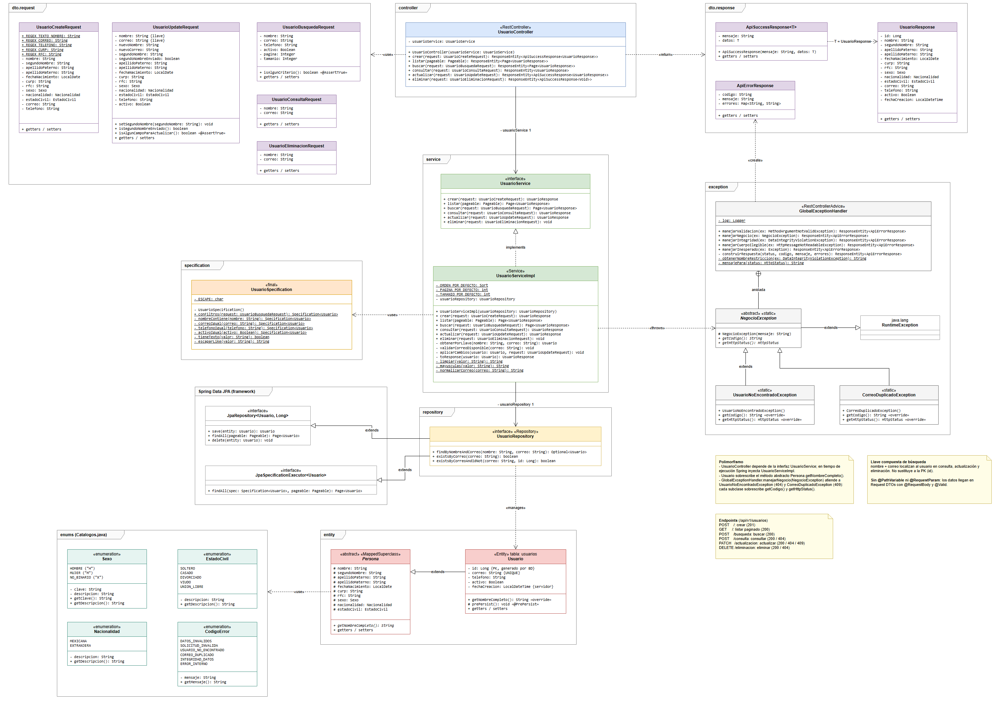

# Api_R1: API REST para la administración de usuarios

## 1. Descripción del proyecto

API REST para registrar, consultar, buscar, actualizar y eliminar usuarios, desarrollada con **Java 17, Spring Boot 3 y Spring Data JPA** sobre **PostgreSQL (Neon)**.

La implementación sigue una arquitectura por capas y las restricciones de la actividad:

- **No** se usa `@PathVariable` ni `@RequestParam`: toda la información llega en **Request DTOs** con `@RequestBody`.
- Todos los DTOs se validan con **Bean Validation** mediante `@Valid`.
- Los errores se centralizan en **`GlobalExceptionHandler`** (`@RestControllerAdvice`), sin `try-catch` en los controladores.
- Los controladores **nunca** reciben ni devuelven entidades JPA.
- Un usuario se localiza con la **llave compuesta nombre + correo**; no existe consulta por ID.
- La **búsqueda dinámica** se resuelve con `Specification<Usuario>` en un único endpoint.

### Arquitectura y responsabilidades por capa

Paquete base: `com.proyecto.usuarios`

| Capa (paquete) | Clase | Responsabilidad |
| :--- | :--- | :--- |
| (raíz) | `UsuariosApplication` | Arranque de la aplicación, información de OpenAPI y formato JSON de las páginas |
| `controller` | `UsuarioController` | Recibe las solicitudes, valida con `@Valid`, delega al servicio y construye la respuesta HTTP |
| `service` | `UsuarioService` | Contrato (interfaz) de las operaciones de negocio |
| `service` | `UsuarioServiceImpl` | Reglas de negocio: existencia del usuario, unicidad del correo, normalización y operaciones CRUD |
| `repository` | `UsuarioRepository` | Acceso a datos con Spring Data JPA y `JpaSpecificationExecutor` para las búsquedas dinámicas |
| `entity` | `Persona` | Clase abstracta (`@MappedSuperclass`) con los datos personales |
| `entity` | `Usuario` | Entidad de la tabla `usuarios`; hereda de `Persona` |
| `dto.request` | `UsuarioCreateRequest`, `UsuarioUpdateRequest`, `UsuarioBusquedaRequest`, `UsuarioConsultaRequest`, `UsuarioEliminacionRequest` | Datos de entrada de cada operación, con sus validaciones |
| `dto.response` | `UsuarioResponse`, `ApiSuccessResponse<T>`, `ApiErrorResponse` | Datos de salida y estructura uniforme de respuestas exitosas y de error |
| `exception` | `GlobalExceptionHandler` | Manejo centralizado de errores (`@RestControllerAdvice`) y excepciones de negocio anidadas |
| `specification` | `UsuarioSpecification` | Construcción dinámica de las condiciones de búsqueda |
| `enums` | `Catalogos` | Enums `Sexo`, `EstadoCivil`, `Nacionalidad` y `CodigoError` |

---

## 2. Tecnologías utilizadas

| Tecnología | Versión | Uso |
| :--- | :--- | :--- |
| Java | 17 o superior | Lenguaje |
| Spring Boot | 3.5.6 | Web, validación y configuración |
| Spring Data JPA / Hibernate | 3.5 / 6.6 | Persistencia y `Specification` |
| Bean Validation (Hibernate Validator) | 8 | Validaciones de los DTOs |
| PostgreSQL (Neon) | 17 | Base de datos |
| springdoc-openapi | 2.8.9 | Swagger UI / OpenAPI |
| Lombok | Gestionada por Spring Boot | Getters, setters, builders y logs |
| JUnit 5, Mockito, MockMvc | Gestionada por Spring Boot | Pruebas |
| Embedded PostgreSQL (zonky) | 2.1.0 | PostgreSQL real para las pruebas de integración |
| Maven | 3.9 | Construcción |

---

## 3. Configuración de PostgreSQL

### Neon (base de datos del proyecto)

| Dato | Valor |
| :--- | :--- |
| Proyecto Neon | `api-usuarios-r1` |
| Base de datos | `usuarios_db` |
| Rol propietario | `usuarios_owner` |
| Versión | PostgreSQL 17 |

El esquema se crea con **[`db/script_bd.sql`](db/script_bd.sql)**, que ya se ejecutó en Neon. Contiene:

- La tabla `usuarios`, con `id` `GENERATED ALWAYS AS IDENTITY` y `fecha_creacion` con valor por defecto del servidor.
- Restricciones `UNIQUE` en `correo`, `curp` y `rfc`.
- Restricciones `CHECK` de formato (correo en minúsculas, teléfono de 10 dígitos, CURP y RFC) y de catálogos (los valores de los enums).
- Índices para la búsqueda dinámica: `pg_trgm` sobre `lower(nombre)` para la coincidencia parcial, `telefono` y `fecha_creacion`.

> Las validaciones de la aplicación **no sustituyen** a las de la base de datos: ambas se aplican.

### Conexión

La aplicación lee la conexión de **variables de entorno**, para que ninguna contraseña quede en el repositorio (ver [`.env.example`](.env.example)):

| Variable | Ejemplo |
| :--- | :--- |
| `DB_URL` | `jdbc:postgresql://<host-de-neon>/usuarios_db?sslmode=require` |
| `DB_USERNAME` | `usuarios_owner` |
| `DB_PASSWORD` | contraseña del rol en Neon |
| `PORT` | `8080` (Railway la asigna automáticamente) |

Los valores se obtienen en la consola de Neon: proyecto **api-usuarios-r1**, opción **Connect**, base `usuarios_db`.

**PostgreSQL local (opcional):** crear la base con `CREATE DATABASE usuarios_db;`, ejecutar `db/script_bd.sql` y usar `DB_URL=jdbc:postgresql://localhost:5432/usuarios_db`.

---

## 4. Instrucciones de ejecución

### Desde IntelliJ IDEA

1. **File > Open** y elegir la carpeta del proyecto (se detecta el `pom.xml`).
2. **Run > Edit Configurations > UsuariosApplication > Environment variables** y agregar `DB_URL`, `DB_USERNAME` y `DB_PASSWORD`.
3. Ejecutar `UsuariosApplication`.

### Desde la terminal (Maven)

```powershell
$env:DB_URL = "jdbc:postgresql://<host-de-neon>/usuarios_db?sslmode=require"
$env:DB_USERNAME = "usuarios_owner"
$env:DB_PASSWORD = "<password-de-neon>"
mvn spring-boot:run
```

| Acción | Comando |
| :--- | :--- |
| Compilar | `mvn compile` |
| Ejecutar pruebas (no requiere Neon) | `mvn test` |
| Generar el JAR | `mvn package` |
| Ejecutar el JAR | `java -jar target/usuarios-0.0.1-SNAPSHOT.jar` |

### Documentación Swagger / OpenAPI

- Swagger UI: **`http://localhost:8080/swagger-ui.html`**
- OpenAPI JSON: `http://localhost:8080/v3/api-docs`

### Despliegue (Railway + Neon)

La API está desplegada en Railway, conectada a la base `usuarios_db` de Neon:

- **API:** `https://api-usuarios-production-8bcf.up.railway.app/api/v1/usuarios`
- **Swagger UI:** **https://api-usuarios-production-8bcf.up.railway.app/swagger-ui.html**

El servicio `api-usuarios` del proyecto `api-usuarios-r1` en Railway compila la rama **`develop`** con Maven (`-DskipTests`) y se vuelve a desplegar con cada push a esa rama. Las variables `DB_URL`, `DB_USERNAME`, `DB_PASSWORD` y `PORT` se configuran en el servicio, no en el repositorio.

---

## 5. Endpoints implementados

Ruta base: **`/api/v1/usuarios`**

| Método | Endpoint | Descripción | Éxito | Errores |
| :--- | :--- | :--- | :--- | :--- |
| **POST** | `/api/v1/usuarios` | Registrar usuario | 201 | 400, 409 |
| **GET** | `/api/v1/usuarios` | Listar usuarios (paginado) | 200 | Ninguno |
| **POST** | `/api/v1/usuarios/busqueda` | Búsqueda dinámica con criterios combinables | 200 | 400 |
| **POST** | `/api/v1/usuarios/consulta` | Consultar por llave compuesta (nombre + correo) | 200 | 400, 404 |
| **PATCH** | `/api/v1/usuarios/actualizacion` | Actualización parcial | 200 | 400, 404, 409 |
| **DELETE** | `/api/v1/usuarios/eliminacion` | Eliminar por llave compuesta | 200 | 400, 404 |

### Reglas definidas para el proyecto

**Búsqueda dinámica (`/busqueda`)**
- `nombre` busca por **coincidencia parcial**, sin distinguir mayúsculas: `lower(nombre) LIKE %texto%`. Los caracteres `%` y `_` se escapan.
- `correo`, `telefono` y `activo` buscan por **coincidencia exacta**.
- Los criterios omitidos, `null` o vacíos **se excluyen** de la consulta; los enviados se combinan con **AND**.
- Se exige **al menos un criterio**, y el resultado siempre se **pagina** (`pagina` desde 0 y `tamanio` de 1 a 50, 10 por defecto). Así se evitan consultas costosas.
- El filtrado y la paginación los hace la base de datos; no se filtra en memoria.

**Listado (`GET`)**: paginado y ordenado del más reciente al más antiguo. Por defecto devuelve 10 registros y como máximo 50.

**Actualización parcial (`/actualizacion`)**
- `nombre` y `correo` (obligatorios) identifican al usuario **antes** de modificarlo.
- Para cambiar la llave se envían `nuevoNombre` y/o `nuevoCorreo`. El nuevo correo se valida (formato y unicidad, excluyendo al propio usuario); si ya pertenece a otro usuario, la respuesta es **409**.
- Un campo **omitido o enviado con `null` no se modifica**, para no sobrescribir datos por accidente.
- **Excepción:** `segundoNombre` (el único dato personal opcional) enviado **explícitamente con `null` se borra**; si se omite, no cambia. Así se distingue un campo omitido de uno enviado con `null`.
- Si no se envía ningún campo a modificar, la respuesta es **400**.

**Eliminación (`/eliminacion`)**: es **física** (el registro se borra de la tabla) y la respuesta es **200** con un mensaje de confirmación.

**Campos controlados por el servidor**: `id`, `activo` (al crear) y `fechaCreacion`. Los DTOs de creación no los incluyen; si el cliente los envía, se ignoran.

**Normalización**: el correo se guarda en minúsculas; la CURP y el RFC, en mayúsculas.

### Validaciones (Bean Validation)

| Anotación | Uso en el proyecto |
| :--- | :--- |
| `@NotBlank` | Textos obligatorios: nombre, apellidos, correo y teléfono (rechaza `null`, `""` y solo espacios) |
| `@NotEmpty` | CURP y RFC (rechaza `null` y `""`; los espacios y el formato los rechaza `@Pattern`) |
| `@NotNull` | Campos no texto obligatorios: `fechaNacimiento`, `sexo`, `nacionalidad` y `estadoCivil` |
| `@Email` | Formato del correo (con expresión que exige dominio) |
| `@Pattern` | Teléfono (`^[0-9]{10}$`), CURP, RFC y nombres (solo letras y espacios) |
| `@Size` | Longitudes máximas (60 en nombres y 120 en correo) |
| `@Past` | La fecha de nacimiento debe ser pasada |
| `@Min` / `@Max` | Página y tamaño de página de la búsqueda |
| `@AssertTrue` | Al menos un criterio de búsqueda y al menos un campo para actualizar |

### Manejo de errores (`GlobalExceptionHandler`)

Todas las respuestas de error tienen la misma estructura (`ApiErrorResponse`):

```json
{ "codigo": "DATOS_INVALIDOS", "mensaje": "Verifique la información capturada e intente nuevamente.", "errores": { "campo": "mensaje" } }
```

| Situación | Excepción | HTTP | `codigo` |
| :--- | :--- | :--- | :--- |
| Validación de DTO | `MethodArgumentNotValidException` | 400 | `DATOS_INVALIDOS` |
| JSON mal formado o valor fuera de catálogo | `HttpMessageNotReadableException` | 400 | `SOLICITUD_INVALIDA` |
| Usuario no encontrado | `UsuarioNoEncontradoException` | 404 | `USUARIO_NO_ENCONTRADO` |
| Correo duplicado | `CorreoDuplicadoException` | 409 | `CORREO_DUPLICADO` |
| CURP o RFC duplicados / integridad | `DataIntegrityViolationException` | 409 | `INTEGRIDAD_DATOS` |
| Ruta inexistente / método no permitido | Excepciones de Spring MVC | 404 / 405 | `SOLICITUD_INVALIDA` |
| Error inesperado (se registra en el log) | `Exception` | 500 | `ERROR_INTERNO` |

`UsuarioNoEncontradoException` y `CorreoDuplicadoException` heredan de la clase abstracta `NegocioException`. Un solo método, `manejarNegocio`, atiende a ambas gracias al **polimorfismo**: cada subclase sobrescribe `getCodigo()` y `getHttpStatus()`. Nunca se devuelven trazas, consultas SQL ni nombres internos.

---

## 6. Ejemplos de peticiones y respuestas

### Crear usuario
```bash
curl -X POST "http://localhost:8080/api/v1/usuarios" \
  -H "Content-Type: application/json" \
  -d '{
    "nombre": "Juan",
    "segundoNombre": "Carlos",
    "apellidoPaterno": "Perez",
    "apellidoMaterno": "Gomez",
    "fechaNacimiento": "1990-01-01",
    "curp": "PEGJ900101HGTRRN09",
    "rfc": "PEGJ900101AB1",
    "sexo": "HOMBRE",
    "nacionalidad": "MEXICANA",
    "estadoCivil": "SOLTERO",
    "correo": "juan.perez@correo.com",
    "telefono": "4771234567"
  }'
```
**HTTP 201**
```json
{
  "mensaje": "Usuario registrado correctamente.",
  "datos": {
    "id": 1, "nombre": "Juan", "segundoNombre": "Carlos", "apellidoPaterno": "Perez", "apellidoMaterno": "Gomez",
    "fechaNacimiento": "1990-01-01", "curp": "PEGJ900101HGTRRN09", "rfc": "PEGJ900101AB1",
    "sexo": "HOMBRE", "nacionalidad": "MEXICANA", "estadoCivil": "SOLTERO",
    "correo": "juan.perez@correo.com", "telefono": "4771234567", "activo": true,
    "fechaCreacion": "2026-10-14T10:30:00"
  }
}
```
Si el correo ya existe, **HTTP 409**:
```json
{ "codigo": "CORREO_DUPLICADO", "mensaje": "El correo ya se encuentra registrado. Intente con otro correo." }
```

### Listar usuarios (paginado)
```bash
curl "http://localhost:8080/api/v1/usuarios"
```
**HTTP 200**
```json
{ "content": [ { "id": 1, "nombre": "Juan", "...": "..." } ], "page": { "size": 10, "number": 0, "totalElements": 1, "totalPages": 1 } }
```

### Búsqueda dinámica
```bash
curl -X POST "http://localhost:8080/api/v1/usuarios/busqueda" \
  -H "Content-Type: application/json" \
  -d '{ "nombre": "Juan", "correo": null, "telefono": null, "activo": true }'
```
**HTTP 200**: la misma estructura paginada (`content` + `page`), con los usuarios activos cuyo nombre contiene "juan".

### Consultar por llave compuesta
```bash
curl -X POST "http://localhost:8080/api/v1/usuarios/consulta" \
  -H "Content-Type: application/json" \
  -d '{ "nombre": "Juan", "correo": "juan.perez@correo.com" }'
```
**HTTP 200**: el `UsuarioResponse`. Si no hay coincidencia, **HTTP 404**:
```json
{ "codigo": "USUARIO_NO_ENCONTRADO", "mensaje": "No existe un usuario con el nombre y correo electrónico proporcionados." }
```

### Actualizar parcialmente
```bash
curl -X PATCH "http://localhost:8080/api/v1/usuarios/actualizacion" \
  -H "Content-Type: application/json" \
  -d '{ "nombre": "Juan", "correo": "juan.perez@correo.com", "telefono": "4779876543", "activo": true }'
```
**HTTP 200**
```json
{ "mensaje": "Usuario actualizado correctamente.", "datos": { "id": 1, "telefono": "4779876543", "...": "..." } }
```

### Eliminar
```bash
curl -X DELETE "http://localhost:8080/api/v1/usuarios/eliminacion" \
  -H "Content-Type: application/json" \
  -d '{ "nombre": "Juan", "correo": "juan.perez@correo.com" }'
```
**HTTP 200**
```json
{ "mensaje": "Usuario eliminado correctamente." }
```

### Error de validación
**HTTP 400**
```json
{
  "codigo": "DATOS_INVALIDOS",
  "mensaje": "Verifique la información capturada e intente nuevamente.",
  "errores": {
    "nombre": "El nombre es obligatorio y no puede contener solo espacios.",
    "correo": "El correo electrónico no tiene un formato válido."
  }
}
```

---

## 7. Explicación del consumo de servicios REST

1. El cliente (Swagger UI, Postman, cURL o un frontend) envía una petición HTTP a alguno de los endpoints de `/api/v1/usuarios`. Cuando hay datos, van en un **JSON en el cuerpo** con `Content-Type: application/json`.
2. **`UsuarioController`** convierte el JSON en el Request DTO correspondiente y lo valida con `@Valid`. Si alguna regla falla, `GlobalExceptionHandler` responde **400** con el detalle por campo, sin llegar al servicio.
3. **`UsuarioServiceImpl`** aplica las reglas de negocio: normaliza los datos, verifica que el usuario exista y que el correo sea único, y decide qué campos cambian.
4. **`UsuarioRepository`** (Spring Data JPA) ejecuta las consultas con parámetros, sin concatenar valores en SQL. La búsqueda dinámica usa la `Specification` que arma **`UsuarioSpecification`**.
5. El servicio convierte la entidad en **`UsuarioResponse`**, y el controlador lo devuelve con el código HTTP adecuado: 201 al crear, 200 en los demás casos.
6. Si ocurre un error de negocio o de base de datos, la excepción llega a **`GlobalExceptionHandler`**, que devuelve un `ApiErrorResponse` con el código HTTP correspondiente.

**Por qué `POST`/`PATCH`/`DELETE` con cuerpo en lugar de rutas con parámetros:** la actividad prohíbe `@PathVariable` y `@RequestParam`. Por eso la llave compuesta y los criterios viajan en el cuerpo de la petición.

---

## 8. Evidencia de pruebas realizadas

Ejecución de `mvn test`: **32 pruebas, 0 fallas**.

- **`UsuarioApiIntegrationTest`** (26 pruebas): prueba los endpoints de extremo a extremo con MockMvc contra un **PostgreSQL real** (embebido), creado con `db/script_bd.sql`. Hibernate valida el esquema (`ddl-auto=validate`).
- **`UsuarioServiceImplTest`** (6 pruebas): pruebas unitarias con Mockito de las reglas del servicio (normalización, correo duplicado, `segundoNombre` omitido o `null`, usuario inexistente).

Las solicitudes y respuestas reales de los 25 escenarios (casos exitosos, validaciones, 404, 409, JSON mal formado, ruta inexistente y método no permitido) están en **[`docs/evidencias-pruebas.md`](docs/evidencias-pruebas.md)**.

El mismo archivo incluye las **pruebas en producción**: 10 casos (alta, duplicado, validación, listado, búsqueda, consulta, 404, modificación y baja) ejecutados contra la API desplegada en Railway, con los datos guardados en Neon.

---

## 9. Diagrama de clases

Archivo editable en draw.io: [`docs/diagrama-clases.drawio`](docs/diagrama-clases.drawio)



Incluye:
- **Interfaces:** `UsuarioService` y `UsuarioRepository`.
- **Clases abstractas:** `Persona` y `NegocioException`.
- **Herencia:** `Usuario` hereda de `Persona`; las excepciones de negocio heredan de `NegocioException`.
- **Polimorfismo:** la inyección de `UsuarioService`, la sobrescritura de `getNombreCompleto()` y el manejo de `NegocioException`.
- **Enums:** los catálogos de `Catalogos.java`.

---

## Entregables

| Entregable | Ubicación |
| :--- | :--- |
| Código fuente | `src/main/java` |
| Script de base de datos PostgreSQL | [`db/script_bd.sql`](db/script_bd.sql) |
| Diagrama de clases (imagen) | [`docs/diagrama-clases.png`](docs/diagrama-clases.png) |
| README | este archivo |
| Evidencias de pruebas | [`docs/evidencias-pruebas.md`](docs/evidencias-pruebas.md) |
| URL de despliegue (Railway) | https://api-usuarios-production-8bcf.up.railway.app/swagger-ui.html |

## Ramas del repositorio

| Rama | Contenido |
| :--- | :--- |
| `main` | Rama principal |
| `develop` | Integración de todo el trabajo |
| `docs/estructura-diseno-bd` | Documentación, estructura del proyecto y diseño de la base de datos |
| `feature/implementacion-api` | Implementación del código, pruebas y README |
